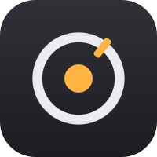
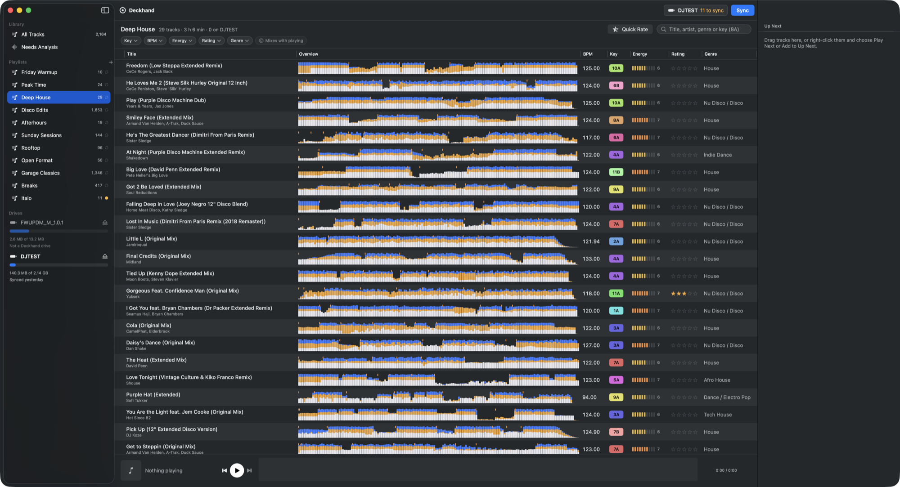

<p align="center">
  <a href="https://deckhand.rocks"></a>
</p>

<h1 align="center">Deckhand</h1>

<p align="center">
  <strong>Your music library, ready for the decks.</strong><br>
  <a href="https://deckhand.rocks">deckhand.rocks</a>
</p>

Deckhand imports tracks and playlists from Apple Music, Rekordbox XML, or folders into a local library,
then syncs to a Pioneer DJ / AlphaTheta USB drive (OneLibrary format) with key, BPM, beat grids, waveforms
and hot cues already set. Playlists and ratings save in Deckhand; audio stays in place.

Free and open source · macOS 14+



```
Music / Rekordbox XML / Folders  →  Deckhand library  →  USB  →  the decks
```

## Features

- **Its own analysis.** BPM, beat grid, key, energy and song structure, all worked out on your Mac. No other
  apps and no tag cleanup. Phrase colors (Intro, Build, Breakdown, Drop, Outro) show up on the deck.
- **Named hot cues.** A–H land on the mix in, builds, drops and mix out on every track. You can write
  memory cues too, or neither.
- **Incremental syncs.** New tracks get copied and renamed or reordered playlists get updated. Deckhand never
  formats a drive, it stages changes and commits them at the end, and it keeps the play history your deck
  wrote.
- **Camelot keys everywhere.** A key wheel filter and "Mixes with now playing" (compatible key, tempo within
  pitch range) help you find the next track.
- **Playlists and ratings, saved locally.** Keep them across source changes and restarts. Explicitly sync
  playlist copies and edited ratings to Music, export Rekordbox XML, or send them to a drive.
- **Quick Rate.** Plays each unrated track from just before its first drop. One key rates it and moves on.
- **Keyboard first.** Browse, preview, queue and rate without touching the mouse.
- **A Mac app and a CLI.** Use the SwiftUI app, or script everything with `deckhand`.


## Deckhand library

On first launch, choose **Apple Music / iTunes**, **Rekordbox** (a collection XML export),
**Folder on Computer**, or **Start Empty**. All imports join one Deckhand library; playlists can mix
tracks from different imports. Your saved tracks, playlists and ratings persist independently of imports.

Every edit saves locally in `~/Library/Application Support/Deckhand/Library/library.sqlite`.
**Add Music…** brings tracks and playlists into the same library. **Library Settings** keeps import
history with an optional **Re-import** action for each input. Opening the library reads saved data;
external changes arrive only when you import them.
**Sync USB** sends the chosen content directly to the selected drive. Library → **Export Playlists…**
sends playlist copies to a Deckhand folder in Music or exports Rekordbox XML. Audio stays at its original
paths. Empty folders work too: add audio, then re-import that folder from Library Settings.

The CLI uses the saved library for playlists, analysis, status and sync once initialized. Before that
it reads Music; `--music` explicitly selects Music for analyze/status/sync. USB analysis comes from
Deckhand. File relocation and continuous two-way sync are future work.
See [the source plan](docs/plans/library-sources.md) and [test report](docs/plans/dedicated-library-e2e.md).

## Requirements

- macOS 14 or later
- Xcode command line tools (Swift 6)
- SQLCipher: `brew install sqlcipher`
- Music files you own (purchased or imported). DRM-protected Apple Music streaming tracks can't be copied to a
  USB drive by anyone, so Deckhand skips them and lists which ones it skipped.

## Install

There are no prebuilt binaries yet, so you build from source.

```sh
git clone https://github.com/harlow/deckhand.git
cd deckhand
brew install sqlcipher
```

### Mac app

```sh
Scripts/build-app.sh          # or `Scripts/build-app.sh debug`
open build/Deckhand.app
```

This builds `build/Deckhand.app`, an ad-hoc signed bundle with the `deckhand` CLI inside it (the app runs the
CLI to analyze and sync). On first launch, allow Media & Apple Music access. The prompt can end up hidden
behind other windows, and the library won't load until you click Allow. Each rebuild changes the ad-hoc
signature, so macOS asks again after every rebuild. More detail is in [docs/mac-app.md](docs/mac-app.md).

### CLI

```sh
swift build -c release --product deckhand
.build/release/deckhand --help
```

To put it on your PATH, copy `.build/release/deckhand` to a directory like `/usr/local/bin`. The first run may
ask for Media & Apple Music access.

## Usage

In the app, pick playlists in the sidebar, pick a drive, and press **Sync**.

From the command line, you analyze and then sync:

```sh
deckhand analyze                                  # whole library; cached, so only new tracks next time
deckhand init /Volumes/DJUSB                      # once per drive: mark it as Deckhand's (never formats)
deckhand sync /Volumes/DJUSB --playlist "House" --playlist "Friday"   # add --entire-library for every song too
deckhand sync /Volumes/DJUSB                      # later syncs reuse the drive's saved selection and settings
deckhand eject /Volumes/DJUSB
```

`sync` doesn't analyze on its own, which keeps it fast. If some tracks haven't been analyzed, it asks whether
to analyze them first. Pass `--analyze` or `--no-analyze` to skip the question. Tracks that sync without
analysis get their analysis files on a later sync. `--dry-run` shows what would change without writing anything.

Output settings are saved per drive, so you pass them once: `--key-format classic|alphanumeric`,
`--cues memory|hot|both|none`, `--hot-cues named|phrase`, `--build-lead 8|16|32`, `--track-color energy|none`,
`--no-phrases`.

Other commands:

| Command | What it does |
|---|---|
| `playlists`, `devices` | List saved library playlists and mounted drives |
| `status`, `validate` | Show exactly what the next sync would change (`--json` for scripts), and check a drive's library for problems |
| `sync --adopt` | Take over audio that's already on a drive (for example, from a Rekordbox export) instead of copying it again |
| `import-playlists` | Recreate a drive's existing playlists in Apple Music (`--add-missing` also adds tracks Music doesn't have) |
| `cleanup` | Remove leftovers from other tools that nothing on the drive uses (`--dry-run` first) |
| `ratings backup` / `ratings restore` | Back up Apple Music star ratings, or put them back |

## Hardware compatibility

| Player | Status |
|---|---|
| AlphaTheta OMNIS-DUO | **Confirmed:** browsing, playback, artwork, hot cues, play history |
| XDJ-AZ, OPUS-QUAD, CDJ-3000X and other OneLibrary players | Untested. They read the same format, but nobody has tried them yet |
| Older players that need `export.pdb` (CDJ-3000, CDJ-2000NXS2, ...) | Not supported. Deckhand writes OneLibrary only |

If you try Deckhand on another player, please open an issue and say what worked and what didn't. Test with a
spare stick, because `sync` replaces `PIONEER/rekordbox/exportLibrary.db`. Afterwards, run
`deckhand validate /Volumes/X`: new `ANLZ0001.*` files on the stick mean the player re-analyzed tracks
instead of using Deckhand's analysis.

## Project layout

| Target | Role |
|---|---|
| `DeckhandApp` | The SwiftUI Mac app (bundled by `Scripts/build-app.sh`) |
| `deckhand` | The CLI |
| `Sync` | Planner (diff), executor (copy, analyze, stage, commit), manifest, analysis cache |
| `OneLibrary` | ANLZ writer, `exportLibrary.db` writer, validator |
| `Analysis` | Decoding (AVFoundation), waveforms, BPM and beat grid, key ensemble, cues, energy, song structure |
| `MusicSource` | Music, folder and Rekordbox XML import adapters |
| `DeckhandLibrary` | Persistent local library and explicit Music export |
| `DeckhandCore` | Normalized source model, `TrackAnalysis`, `MusicalKey` |
| `CQMDSP` | Vendored [qm-dsp](https://github.com/c4dm/qm-dsp) (GPL) for beat tracking and key features |
| `CKeyFinder` | Vendored [libKeyFinder](https://github.com/mixxxdj/libkeyfinder) (GPL-3) with an Accelerate FFT backend |
| `CSQLCipher` | SQLCipher system library (Homebrew) for the encrypted OneLibrary database |
| `EvalSupport` | Eval-only helpers: the reference-label reader and file-tag parsing used by the `deckhand-*-eval` tools (not linked into the app or CLI) |
| `deckhand-eval`, `deckhand-grid-eval`, `deckhand-cue-eval`, `deckhand-structure-eval` | Accuracy evaluation and training-data export for key, beat grid, cues/energy, and structure |

Format notes are in [docs/formats.md](docs/formats.md), and the full product spec is in
[docs/deckhand-product-spec.md](docs/deckhand-product-spec.md).

## Analysis models

The shipped models are small, and their weights are compiled into `Sources/Analysis`. Training happens
offline in Python against reference labels. The `deckhand-*-eval` tools then check that the Swift code matches
Python and measure accuracy on held-out tracks.

- **Key:** a fine-tuned [S-KEY](https://github.com/deezer/skey) ChromaNet (Core ML) in an ensemble with
  linear and libKeyFinder estimates. See [Scripts/key-training/README.md](Scripts/key-training/README.md).
- **Song structure / phrases:** see [Scripts/structure-model/README.md](Scripts/structure-model/README.md).
- **Cues and energy:** see [Scripts/cue-model/README.md](Scripts/cue-model/README.md).

## License

Deckhand is licensed under [GPL-3.0-or-later](LICENSE). It includes vendored code from
[libKeyFinder](Sources/CKeyFinder/LICENSE) (GPL-3.0) and [qm-dsp](Sources/CQMDSP/COPYING) (GPL), and the S-KEY
model is derived from Deezer's MIT-licensed release. See [THIRD_PARTY_NOTICES](THIRD_PARTY_NOTICES) for every
third-party component and its license.

## Disclaimer

Deckhand is an independent project. It is not affiliated with, endorsed by, or sponsored by AlphaTheta, Pioneer
DJ or Apple. Rekordbox, OneLibrary, CDJ, XDJ and OMNIS-DUO are trademarks of AlphaTheta Corporation, and Apple
Music is a trademark of Apple Inc. The drive format was worked out through interoperability research. Use a
spare drive until you trust it.
