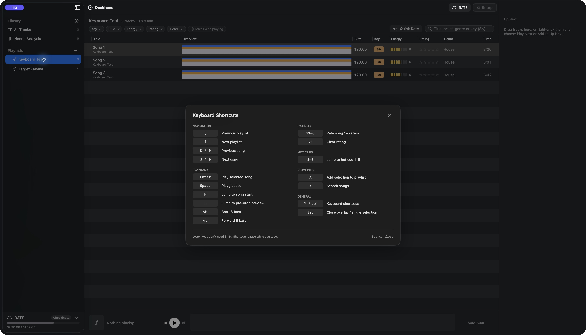

# Deckhand Mac app

A native Mac app for browsing the library with everything Apple Music doesn't show (key, energy, cues,
waveforms, sync state) and for syncing drives. The first half of this page describes what's built; the
rest is the design for what comes next.

## Build and run

`Sources/DeckhandApp` (SwiftUI, Apple Silicon, macOS 26+):

```sh
Scripts/build-app.sh          # or `Scripts/build-app.sh debug`; writes build/Deckhand.app (ad-hoc signed)
open build/Deckhand.app
```

The bundle contains the `deckhand` CLI next to the app, which the app runs for analyzing and syncing.
App builds statically link pinned SQLCipher with Apple CommonCrypto and include all analysis resources
and third-party licenses. No Homebrew libraries or developer tools are required on a user's Mac.
`Scripts/package-release.sh` creates a disk image and matching source archive under `build/release`.
See [the release runbook](releases.md) for version cutting, signing, CI and publishing,
and [standalone-release.md](plans/standalone-release.md) for the dependency audit and QA.
The app must be code-signed (ad-hoc is enough), because the iTunesLibrary framework only returns data
to signed apps.

App icon: the "Platter" mark, drawn by `Scripts/make-icon.swift` at build time. `PlatterMark` in
`Components.swift` draws the same mark in SwiftUI; its one-color version sits next to the window title.

## What works

- **Music imports:** choose Music / iTunes, Rekordbox XML, a folder, or Start Empty on first launch.
  Later launches open the same **Deckhand Library**. Add Music in **Library Settings** (or ⌥⌘L)
  brings tracks and playlists into it.
  **Library Settings** contains import history and an optional **Re-import** action for each input.
  The workspace has no import status row, update command, or update-default preference.
  Saved-library reads never pull external changes; imports preserve local playlists and ratings.
  See [library-sources.md](plans/library-sources.md).
- **Sidebar:** All Tracks combines imports; saved playlists and folders appear with sync badges for the
  chosen drive, without rearranging the list when a USB connects. New playlists always belong to Deckhand.
  Drive and playlist selections are remembered.
- **USB sync:** check the playlists you want on the connected USB. The drive/status button shows
  pending changes and opens a preview of selected playlists and the diff. Sync applies it.
  A USB from an earlier library offers the same blue **Sync** button, with a one-time confirmation
  that verifies its music and keeps its selection before syncing. Unchecking the last playlist opens
  a removal confirmation on sync.
- **Delete a playlist:** right-click it in the sidebar and choose **Delete Playlist…**, then confirm.
  Tracks, ratings and analysis stay in Deckhand. Re-import keeps the playlist deleted; other apps are
  unchanged, and a connected USB is updated only when you sync.
- **Track table:** sortable columns: sync dot, title/artist, three-band waveform overview (click to preview
  from that point), BPM, Camelot key chip, energy bar, genre, time. Search covers title, artist, genre or a
  key like `8A`.
- **Filters:** Camelot key wheel (with "Mixes with playing" and "Energy boost" presets), BPM range,
  minimum energy, minimum rating, genres, and "Mixes with now playing".
- **Playback:** a player bar with a detailed waveform, phrase strip and hot cues A–H (click to seek or jump),
  and an Up Next queue showing transition notes and "Mixes well next" suggestions.
- **Context menu:** Play, Play Next, Add to Up Next, Add to Playlist (in Deckhand), Rating, Show in Finder,
  Remove from Playlist.
- **Local playlists and ratings:** every source saves edits in Deckhand's SQLite database. Untouched
  imports follow refreshes; edited memberships and ratings remain local. External deletions retain saved
  playlists and track references. An offline import leaves the library editable and shows unavailable audio.
- **Export Playlists:** a secondary action in the Library menu. Music gets selected playlist copies
  in a Deckhand folder; updating Music ratings is a separate opt-in. Rekordbox gets a separate XML export containing all saved
  playlists. Local edits never automatically write back.
- **Drag and drop:** drag tracks (or the whole selection) onto a sidebar playlist to add them in Deckhand,
  skipping tracks it already has; or onto Up Next to queue them. Dropping a playlist onto another playlist
  previews the new-track count and asks before copying; duplicates are skipped. Drop onto a folder to
  move inside it, or at the insertion line between rows to reorder at the top level or within a folder.
  Playlist order saves locally and survives re-import.
- **Analysis:** opening the library loads cached results without opening audio files. Needs Analysis
  offers Analyze Library; the Library menu also contains this action. Results reload when it finishes.
- **Sync USB (⇧⌘S):** the toolbar and keyboard command sync the selected drive directly. The bundled CLI uses a temporary snapshot
  of the saved Deckhand library after local writes finish. Progress and Cancel appear in the right pane.
  The engine verifies its result, then the app checks the saved library and drive again. Source changes
  preserve the shared library's identity. Older source-bound drives can be explicitly adopted only when
  their IDs and saved selections survive import. Sync then applies the reviewed changes. The toolbar
  offers Set Up USB for an unprepared drive, or USB Help if a drive cannot be safely matched;
  drive switching and Eject live in the sidebar footer. A mismatch no longer adds a banner to the workspace.



### Keyboard (track list)

Clicking a sidebar playlist (including the already-open one) focuses its tracks. Playlist shortcuts
also put focus in the track list; sidebar arrow navigation stays in the sidebar until Tab. Search
keeps ordinary text entry, including j/k.

| Keys | Action |
|---|---|
| j / k or ↓ / ↑ | Move (J / K extend the selection) |
| ⌘⇧] / ⌘⇧[ | Next / previous playlist in the sidebar (works anywhere in the window) |
| Tab / ⇧Tab | From sidebar into tracks / from tracks back to sidebar |
| ⌘↑ / ⌘↓ | Top / bottom |
| Return / ⇧Return | Play / play from Mix In |
| l (or p) | Preview from just before the first drop |
| Space | Play / pause |
| q / ⇧Q | Add to Up Next / play next |
| ⇧P | Add to playlist (picker: recent playlists first; j/k or ↑↓ move, Space adds or removes and stays open, Return adds and closes, / filters) |
| ⌘→ / ⌘← | Next / previous track |
| 1–8 | Hot cues A–H |
| `,` / `.` | Back / forward 4 beats |
| `<` / `>` | Back / forward 16 beats |
| `[` / `]` | Previous / next section |
| ⌥1–⌥5, ⌥0 | Rate, clear rating |
| m | Toggle "Mixes with now playing" |
| / | Search |
| ⌘L | Show the playing track |
| Delete | Remove from playlist |
| r | Quick Rate |
| ? | Cheat sheet |

### Quick Rate

`r`, or the button by search. Plays the listed tracks that have no rating (current playlist plus
filters), best guesses first, each from 16 beats before its first drop.

- `⌥1`–`⌥5` rate the track and move straight on (the same keys as the track list; plain `1`–`8` jump to
  hot cues).
- `j` moves on without rating and hides the track from Quick Rate for 30 days (kept in Deckhand's
  preferences; nothing is written to Music). `k` goes back to the previous track.
- `g` toggles groove order (on by default): each next track is the queued one that mixes best with the one
  just rated (compatible key, tempo within pitch range, same genre).
- `o` switches between best guesses first and shuffled.
- `⇧P` adds the track to playlists; `,` `.` `[` `]` move within the track; `l` replays the preview;
  Escape ends the session.

The right column shows the session's tally and what's coming up.

**Best guesses first** orders tracks by how likely you are to rate them 4★ or more, with the reason
shown under the title. The score adds up simple signals learned from the tracks you've already rated:
Music's play and skip counts, how you rate that artist and genre, the energy and tempo bands you rate
highly, and membership of playlists full of tracks you like (`Suggestions.swift`).

### Ratings backup

App ratings save immediately in the dedicated library database and survive restart and source changes.
The separate Music commands `deckhand ratings backup` and `deckhand ratings restore` still back up and
restore Music's own ratings. The app no longer runs Music rating backups automatically.

### Performance and diagnostics

The track list is an `NSTableView` (`TrackTable.swift`) with fixed-height rows and SwiftUI cells hosted
only for visible rows; SwiftUI's `Table` measured every row up front and froze for over a minute on a
library of ~2,000 tracks. Drive reads run off the main thread (USB manifests can take seconds), and so do
status evaluations and every Apple Event.

View → Show Console (⌥⌘C) logs slow steps, freezes over 250 ms, actions and job output. The same log goes
to the system log: `/usr/bin/log show --predicate 'subsystem == "rocks.deckhand.app"'`.

### Sync status

Every dot, playlist badge, "N to sync", byte count, "won't fit" and the Sync button's colour come from one value:
the engine's `SyncStatus.evaluate` (through `SyncPlanner.evaluate`, exactly as `deckhand status` and `deckhand
sync` decide), run off the main thread on the app's library, the drive's manifest and files, and the drive's
saved settings. `DeckhandAppCore` holds the parts that don't need a UI, and its tests cover the races below.

- **Facts without hashing.** The app never hashes to evaluate: audio its background analysis load hasn't hashed
  yet is *unknown*, shown as neither synced nor pending, and the evaluation runs again as hashes arrive. Tracks an
  evaluation reports unknown (e.g. Music rewrote the file's tags) are hashed again in the background. Until the
  first evaluation lands the drive shows "Checking…", and with nothing pending but some tracks unknown it shows
  "N not checked" rather than "Up to date". Retained, failed and ineligible tracks show as the engine sees them
  (hover the dot for why). The app picks up hashes and analysis failures the CLI saved after each job and when
  it becomes active.
- **Ordering.** Evaluations can finish out of order; the newest one issued wins (`StatusStore`). Drive reads
  carry sequence tokens (`ReadLedger`), so a slow read never overwrites a newer one or a selection edit the app
  just saved (the drive's files and its manifest are ordered separately: a read begun before an edit still brings
  the newer file scan).
- **After a sync.** The CLI's last line, `@result {...}`, says whether its own self-check was clean. If so the app
  shows the drive clean at once; evaluations begun before the sync ended are dropped (so a rating set in that
  second shows its pending dot once the verification lands). Then it reads the saved library and the
  drive again and evaluates ("verification"); that replaces the optimistic status, and if anything is still
  pending (and nothing was edited during the sync) a note above the track list lists it. The same lines go to the
  Console.
- **Imports.** Music's framework snapshot is overlaid with live fields when available during an explicit
  import. Folder and XML adapters normalize to the same source model. Imports merge transactionally;
  a failed read cannot become an empty replacement.
- **Local saves.** Membership and rating writes serialize in the library actor. The UI applies committed
  snapshots with monotonic revisions so a late result cannot restore an older edit. Sync waits for saves.
- **Reloads.** Foreground activation and post-sync verification check local audio availability and the drive.
  External changes arrive only through Add Music or Re-import in Library Settings.
- **Access.** Music import/export may require Media & Apple Music or Automation permissions. USB sync uses
  the saved Deckhand snapshot and does not require live Music access. Music export failures leave local
  playlists intact and are shown in the destination sheet.
- **Selection edits** (adding or removing playlists, All Tracks) show at once and are saved with `Manifest.edit`;
  the view then takes what was saved. During the app's own sync they wait and are saved when it finishes; if
  another Deckhand is syncing the drive, the edit is undone with an explanation.

### Not built yet

- Editing analysis (BPM/key/grid/cues), smart crates, play history, set planner, library health.
- Genre families in the filter and an optional family-on-drive setting; see [genres.md](genres.md).
- In-app drive initialization: run `deckhand init <drive>` in Terminal first, then choose playlists
  or All Tracks in the app. This works for Music, folder and XML sources.

## Design: screens

The target design. Much of it is built (see above); the rest is planned.

### Library window

- **Toolbar:** search (title, artist, label, or a key like `8A`), a drive pill showing pending changes
  ("DJUSB · 2 changes"), and **Sync**.
- **Sidebar:**
  - Library: All Tracks, Recently Added, Needs Analysis.
  - Playlists, with **+** to add one. Each has a sync badge: green check (up to date on the drive), orange
    count (changes waiting), or dashed circle (not on any drive).
  - Smart Crates (saved filters, see below).
  - Drives: used space, player model, last sync, eject.
- **Playlist header:** track count, length, "40 on DJUSB · 2 waiting to sync", Play and Shuffle Preview.
- **Filter chips:** Key (opens the key wheel), BPM range, Energy, Genre, and **Mixes with now playing**
  (keys within one Camelot step or the relative major/minor, and BPM within pitch range).
- **Track table:** each row has a sync dot, artwork, title/artist, a waveform overview, BPM, a coloured
  Camelot key chip, a 10-segment energy bar, genre and time.
  - The waveform overview is three-band coloured, like Rekordbox, with the detected cue positions as ticks.
    Clicking it previews the track from that point, with a playhead.
  - A track being analyzed shows a progress bar instead of a waveform.
- **Player bar:** a large waveform with hot cues A–H and a phrase strip (Intro / Build / Drop / Break /
  Outro, from song structure), plus transport controls and time.
- **Up Next:** the queue, with a note on each transition ("9A → 10A · +1 BPM · energy ↑", or a "key
  clash" warning) and suggested next tracks scored on key, tempo and energy.

### Key filter popover

A Camelot wheel: minor keys (A) on the inner ring, major keys (B) on the outer. Click keys to select them.
- **Presets:** Mixes with the playing key, Energy boost (+2), Same key only.
- **Pitch option:** also match keys reached by pitching ±6% with Key Lock off.

### Sync sheet

- **What will change:** tracks to copy (with size), tracks to analyze first, playlists to update, removals,
  and new play-history sessions found on the deck (kept).
- **Space:** a bar showing the drive's space after the sync.
- **Settings:** a summary of the drive's saved output settings (cues, hot-cue style, build lead, key format,
  track colour, phrases), with Edit.
- **Options:** "Sync automatically when DJUSB is plugged in" and "Eject when done".

## More features

In rough priority order:

1. **Fixing analysis by hand.** Deckhand's analysis is the only source of key, BPM and cues, so it has to
   be correctable: halve or double the BPM, nudge the downbeat, override the key, and move, add or delete
   cues. Overrides would be stored in Deckhand's cache by audio hash, survive re-analysis, and be flagged
   in the UI.
2. **Smart crates.** Saved filter sets (key, BPM, energy, genre, date added) that update themselves and
   sync to the drive like playlists.
3. **Played on deck.** Read the play history the player writes to the drive (sync already keeps it) and
   turn each gig into a "Played at …" playlist in Apple Music.
4. **Set planner.** A playlist mode that plots key and energy track by track and flags key clashes,
   tempo jumps and energy dips.
5. **Library health.** Duplicates, missing files, DRM tracks that can't sync, and failed analyses.
6. **Auto-sync on plug-in** (opt-in, per drive), with a notification when it's done.

Deferred: using imported Rekordbox grids, cues and keys for playback/USB analysis. XML export preserves
these entries from the input XML, but Deckhand currently analyzes the audio itself.

## Architecture

- **Deckhand owns tracks and playlists.** `DeckhandLibraryStore` persists normalized records, provenance,
  source mappings, edit flags, cached XML and export receipts in one SQLite database. `LocalLibraryStore`
  remains a migration reader for the first per-source implementation.
- **Imports:** `LibrarySourceAdapter` reads folders/XML; `AppleMusicLibrary` and `MusicBridge` read Music.
  All feed the dedicated store. Audio remains in place; imports sharing a resolved path share one track.
- **Explicit Music export:** `MusicExport` checks destination copies and checkpoints receipts. Its serial
  `AppleMusicDestination` writes via `AppleMusicWriter` and `MusicEvents`. Tests substitute a stateful fake.
- **Deckhand's cache** holds everything Music can't: key, energy, beat grid, cues, sections/phrases and
  waveforms (peak/RMS and three bands). The app reads what `deckhand analyze` produces.
- **Stack:** a SwiftUI app target in this package, built on the `Sync` library (and through it
  `Analysis`, `MusicSource` and `OneLibrary`). Sync logic stays in the libraries and the CLI; the app runs
  the bundled `deckhand` CLI for analyze and sync and reads its machine-readable progress
  (`DECKHAND_PROGRESS=1`). Playback uses AVFoundation; waveforms are drawn from the cached waveform data.

## References

- Lexicon library manager: [walkthrough](https://wearecrossfader.co.uk/blog/lexicon-music-management-for-djs/),
  [smartlists](https://rekord.cloud/blog/lexicon-smart-playlists),
  [MusicTech](https://musictech.com/news/gear/dj-library-management-lexicon/)
- In-list waveform preview requests modelled on Rekordbox:
  [NI forum](https://community.native-instruments.com/discussion/585/feature-request-add-waveform-previews-with-hotcues-in-browser),
  [preview player](https://community.native-instruments.com/discussion/693/preview-player-improvements)
- [Apple ITLibrary](https://developer.apple.com/documentation/ituneslibrary/itlibrary);
  [iTunesLibrary on macOS 15.1](https://developer.apple.com/forums/thread/768006)
- [Doug's Scripts: Music playlist scripting](https://dougscripts.com/itunes/pdf/mxplaylistmanager.pdf)
