# Dedicated library: end-to-end validation

**Date:** October 10, 2026<br>
**Build:** `Scripts/build-app.sh debug` → signed `build/Deckhand.app` and bundled CLI<br>
**Decision and behavior:** [library-sources.md](library-sources.md)

## Automated regression coverage

Latest full command: `swift test --scratch-path .build-app`.

The suite passes **220 tests in 43 suites**, including **40 dedicated-library tests** across
`DeckhandLibraryTests`, `MusicExportTests`, `LibrarySyncTests`, and `DedicatedLibraryModelTests`.
Existing source-adapter, engine, recovery, analysis, and UI/core regression suites also run.

The earlier rerun after the user's evidence request passed **211 tests / 43 suites in 25.248 seconds**.
The saved [complete test output](validation-evidence/ux-tests.log) records each test result.
After the startup flash fix, the latest run passed **214 tests / 43 suites in 23.737 seconds**.
See [the startup regression output](validation-evidence/startup-tests.log).

Coverage includes:

- Start empty, create a playlist, import folder → Music snapshot → second folder, and keep a mixed
  playlist and local rating across disconnect/restart. App-model tests isolate preferences and cache.
- Repeated imports preserve IDs and avoid duplicates. Equal resolved paths share a track across adapters;
  separate connections with equal numeric IDs remain distinct. Incomplete All Tracks ordering cannot
  silently drop playlist tracks. Duplicate ordering IDs and invalid track references are rejected.
- Refresh untouched playlists; preserve edited membership and cleared ratings; flag external conflicts.
  External deletions keep playlists and file references. Folder renames keep identity, rating and membership.
- Offline folders, invalid XML, first-import failure, restored sources, and unavailable files after restart.
- SQLite save/import failure via an aborting trigger: both disk and memory roll back. Corrupt/newer schema
  files are not replaced; a second writer is rejected; readers see committed data in the WAL.
- Legacy per-source playlists and ratings migrate once, even offline, without erasing local changes.
- A 10,000-track library: repeated rating edits do not rewrite the source index.
- Explicit Music copies, preserved ordering/duplicates, edited ratings, repeat exports without duplicates,
  missing-audio preflight, external-edit protection, and receipt recovery after a failed export/restart.
  Import refresh ignores the managed Music copies rather than importing its own output again.
- Real planner/executor/device-database integration on temporary test volumes: mixed sources, stable
  ownership/content IDs, disconnect/restart and unavailable source audio. Post-sync checks are clean;
  the OneLibrary validator reports no errors. Legacy adoption requires known ownership and retained IDs.
- Additional imports and individual updates retain the update default. Failed imports do too. Removing
  and re-adding an import retains tracks, playlists, edited ratings, IDs, cached XML and legacy aliases.
  An injected SQLite removal failure rolls back both the default and connection status.
- Stable playlist/sidebar keyboard order with a USB connected; selections and shared-library ownership
  survive default changes, manual updates, restart and reconnect. The app model uses a real temporary
  volume manifest through an injected drive reader, without accessing personal drives.

The Music destination in automated tests is stateful: it records actual remote-like tracks, playlists,
ratings and mutations, and injects failures/external edits. These tests do not send writes to personal Music.

## Initial dedicated-library walkthrough

Temporary fixtures under `/tmp/deckhand-library-qa`:

- A: two generated 12-second WAV files and Friday M3U8 with order and a duplicate entry.
- B: another generated WAV plus a copied audio file, and Peak Set M3U8.
- Rekordbox XML: references existing A/B files, a Weekend folder, RB Set with duplicates, and original
  TEMPO/POSITION_MARK entries.

The signed test bundle used an isolated bundle ID (`com.deckhand.app`),
`DECKHAND_LIBRARY_DIR=/tmp/deckhand-library-qa/Library`, and a separate analysis cache. The normal
bundle keeps `rocks.deckhand.app`. All native interactions used computer-use controls.

| Action | Verified result |
| --- | --- |
| Startup chooser → Folder A through native picker | All Tracks = 2; Friday = 3 with duplicate preserved |
| Rate Closer five stars; create My Mixed Set; add both tracks with ⇧P | Rating and two memberships saved in Deckhand |
| Add Folder B through chooser | All Tracks = 4; Friday and My Mixed Set remain; rating remains |
| Add Peak to My Mixed Set | One saved playlist spans both folder sources, count = 3 |
| Import Rekordbox XML | All Tracks stays 4; Weekend and RB Set imported without duplicating existing paths |
| Remove Peak from RB Set; Refresh Source | RB Set stays at 2; both Warmup entries remain; All Tracks stays 4 |
| Open Sync & Export | Music playlist selection and explicit XML export shown |
| Native Save panel → XML export | All four tracks and four playlists exported; My Mixed Set = 3; RB Set = 2; cue/grid retained |
| Disconnect source | Local Library remains browsable with all saved playlists |
| Quit; rename Folder A to simulate offline disk; relaunch | Four track references, mixed playlist and five-star rating remain; two unavailable files reported |
| Hide original XML; reconnect it | Import error shown; saved library remains accessible |
| Export while original XML and A audio are offline | Cached-XML export is identical to the earlier export |
| Restore audio/XML and refresh | Import recovers, unavailable banner clears, local edits remain |
| Relaunch final build with a fresh cache; Analyze Library | Bundled CLI completes; Needs Analysis clears; BPM/key load across sources |
| Disconnect; Refresh Library; play Peak | Saved library still usable; playback works with no selected import source |

SQLite `PRAGMA integrity_check` returned `ok`. Direct inspection confirmed four saved tracks, five
playlist records (including Weekend folder), three connections, a stable Deckhand library ID, the
mixed membership, cleared active connection, and Closer's five-star rating.

## Actual FAT32 volume and bundled CLI

Created a disposable 128 MB FAT32 disk image, attached and named **DH_LIB_QA**. Only that test image was
initialized or synced. Existing attached drives were not used.

With the isolated library/cache environment, ran:

```sh
deckhand init /Volumes/DH_LIB_QA
deckhand sync /Volumes/DH_LIB_QA \
  --playlist Friday --playlist "My Mixed Set" \
  --playlist "Peak Set" --playlist "RB Set" --entire-library --analyze -y
deckhand validate /Volumes/DH_LIB_QA
```

The bundled CLI reported four tracks, four playlists, four successful analyses, zero failures/removals,
a database write, and a clean self-check with zero pending changes. Validation reported no problems.

After disconnecting the import and taking Folder A offline, a second sync used the saved selection:
zero copies, zero removals, zero database writes, two retained offline tracks, and a clean result.
SHA-256 checks confirmed all four USB audio files remained unchanged. After restoring sources, status
reported the same selected playlists and All Tracks scope as up to date; validation still passed.
The test disk image was ejected afterward and reattached for the later UI checks. Temporary fixtures
remain available for inspection.

## Simplified UX walkthrough

Rebuilt the signed app after the simplification and used the same isolated fixture library and cache.
The complete regression run passed 211 tests in 43 suites in 21.888 seconds. Code-signature verification
also succeeded.

| Action | Verified result |
| --- | --- |
| Open saved library | Fixed Deckhand Library identity, one Playlists section, quiet import status and Add Music action |
| Open Music Imports through settings | Paths, individual Update/Remove controls and a separate default picker |
| Change default from Rekordbox XML to A | Update from A appears; saved collection stays intact |
| Update B | Default remains A |
| Remove B, confirm, then re-add B through native folder picker | Default remains A; All Tracks stays 4; My Mixed Set stays 3; Closer retains five stars; no duplicated import row |
| Open Add Music | Adds to the existing library; no recent-source navigation; explains local playlist ownership and explicit exports |
| Open Library menu and Export Playlists | Sync USB is a separate command; export sheet offers Music copies and XML only |
| Quit and relaunch with isolated environment | No startup chooser; same four tracks, mixed playlist, five-star rating and Update from A |

During these native captures the app did not discover a drive; a removable-volume permission/read was
pending. Computer Use could not access the system notification app, so no connected-USB screenshot is
claimed. USB selection/order/reconnect behavior is covered by the app-model tests above, and the actual
FAT32 sync/validator evidence remains the earlier CLI run. No personal drive was initialized or synced.

### Simplified library

One fixed library identity and one stable playlist list. A, B and Rekordbox XML contribute to the same
saved collection; the update action targets A.

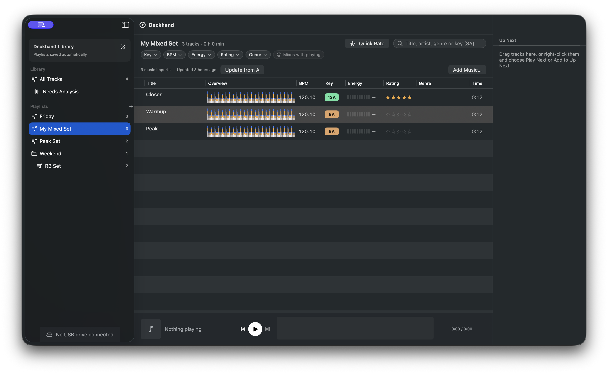

### Music Imports settings

Updating another import does not change the default. Removing an import keeps saved music and playlists.
The connected import list scrolls to show additional rows.

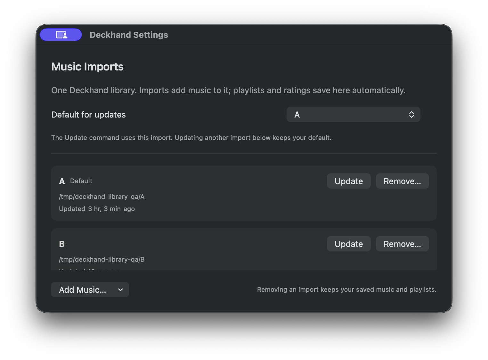

### Add Music

Imports add to the existing Deckhand library. The chooser explains where edits save and what export does.

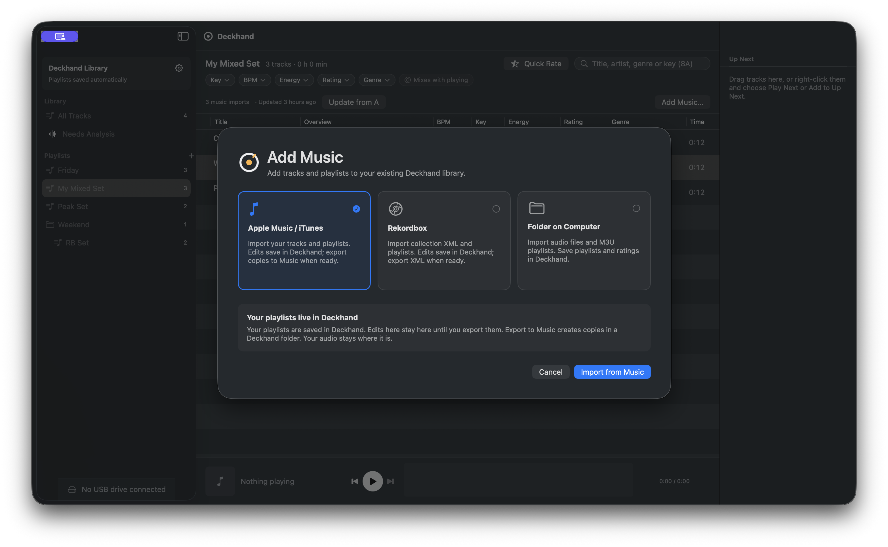

### Secondary exports

Music and XML exports are separate from the primary USB action. This screen demonstrates controls,
not writes to a real Music or Rekordbox desktop library.

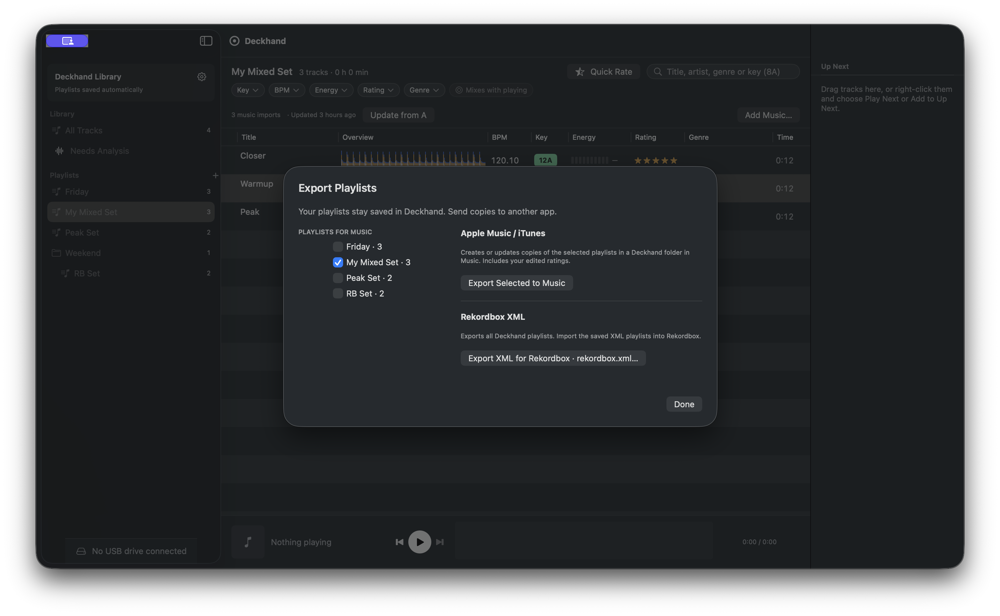

These four unedited native captures were taken at 17:49:28–17:49:57 on October 10, 2026. Originals are
saved under `/Users/harlow/Desktop/SCREENSHOTS/`; review copies are in `docs/images/library-evidence/`.

## Fresh evidence rerun

At 17:52 on October 10, 2026, repeated native and device checks with the isolated fixture library:

| Check | Result |
| --- | --- |
| Set default to Manual imports | Four tracks and every playlist remain; My Mixed Set = 3; Closer = five stars |
| Rename fixture folder A and Refresh Library | Two missing files reported; saved track references, membership and rating remain |
| Restore folder A and refresh | Missing-file notice clears |
| Quit and relaunch | Manual updates, all four tracks, mixed playlist and rating persist; no startup chooser |
| Bundled CLI sync to the disposable FAT32 DH_LIB_QA image | Four tracks/four playlists; clean self-check; zero pending changes |
| Repeat USB sync with A offline and no default import | Two offline tracks retained; zero copies/removals/database writes; clean result |
| Device database validation | `OK — no problems found on DH_LIB_QA.` |
| Code signature and whitespace checks | `codesign --verify --deep --strict build/Deckhand.app` and `git diff --check` succeed |

Saved raw output: [USB sync](validation-evidence/ux-usb-sync.log),
[offline USB sync](validation-evidence/ux-usb-offline.log),
[USB validator](validation-evidence/ux-usb-validate.log).
The target was verified as `/tmp/deckhand-library-qa/USB.dmg` mounted at `/Volumes/DH_LIB_QA`.
No personal drive was written. The native app still did not discover the drive; the permission/read
limitation described above remains, so these USB results come from the bundled CLI and app-model tests.

### Saved library with manual updates

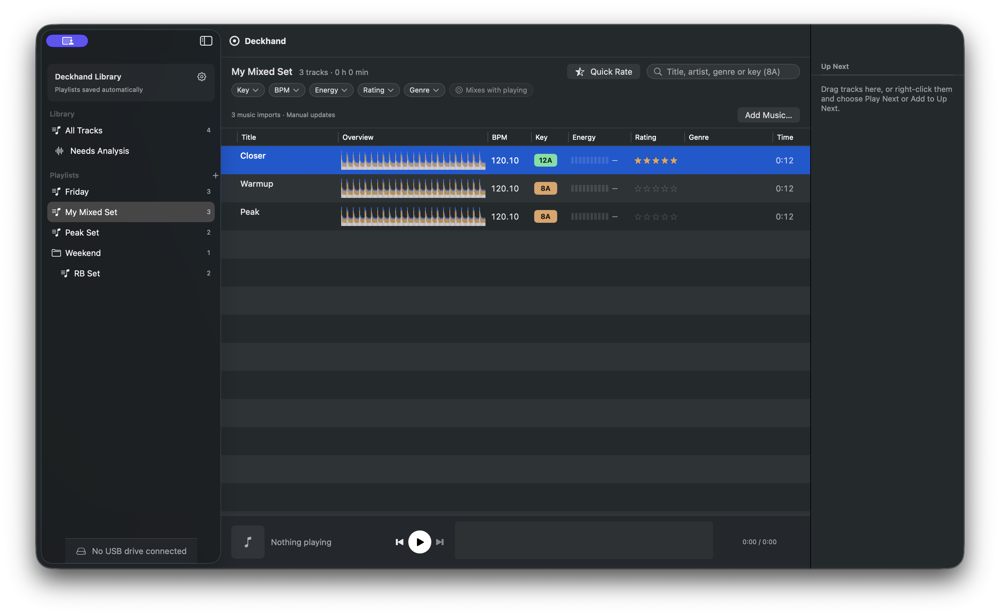

### Offline audio preserves local playlists and ratings

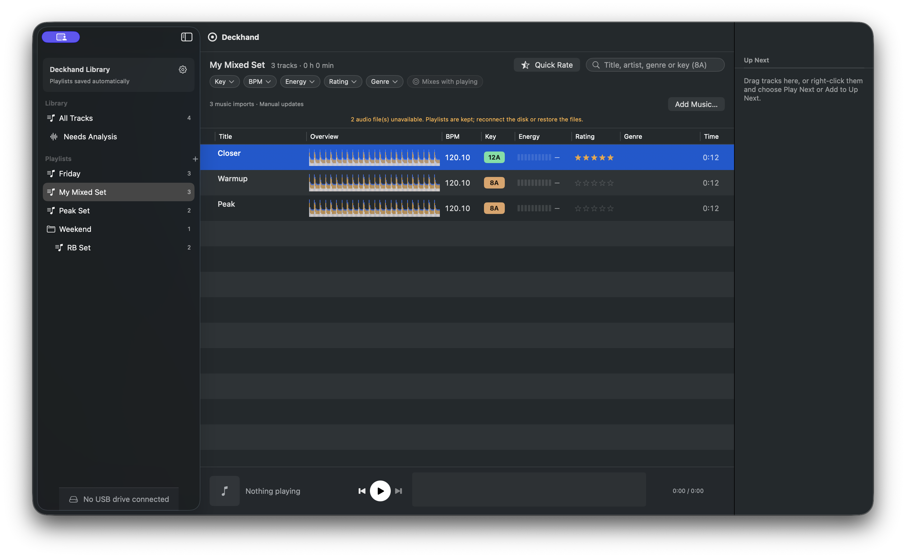

These unedited native captures are saved in the evidence directory; originals are
`/Users/harlow/Desktop/SCREENSHOTS/screenshot-2026-10-10_17-52-36.png` and
`/Users/harlow/Desktop/SCREENSHOTS/screenshot-2026-10-10_17-52-47.png`.

## Startup chooser flash regression

The original content view treated `hasLibrary == false` as first launch before the asynchronous saved
library read had completed. Startup now has an explicit loading state, then routes to the saved
workspace or first-launch chooser after the read. Failed reads show an error with Try Again instead
of onboarding. The regression tests cover the initial state and resolved route for fresh, saved empty,
saved populated and corrupt databases, plus recovery on retry.

The signed native build was checked at 20:32–20:33 on October 10, 2026 with isolated fixture directories:

| Scenario | Verified result |
| --- | --- |
| Existing populated QA library | Workspace opens with four tracks, My Mixed Set = 3 and Closer's five-star rating |
| Fresh directory | First-launch chooser remains available; Start Empty opens the workspace |
| Relaunch that saved empty library | Opens the workspace with zero tracks, without onboarding |
| Corrupt fixture database | Read-error screen with Try Again; no chooser; corrupt data retained |
| Replace invalid fixture with a valid uninitialized database; Try Again | Database is rechecked and first-launch chooser appears |
| Select DH_LIB_QA and click Sync USB | Direct sync finishes successfully; drive shows Up to date; playlist order and local edits remain |

Drive discovery succeeded on this rebuilt diagnostic app; the earlier discovery limitation did not
recur. Only the disposable DH_LIB_QA image was synced. This completes the previously missing native
USB check. The saved-library route is covered by tests; the still captures show the resulting UI.

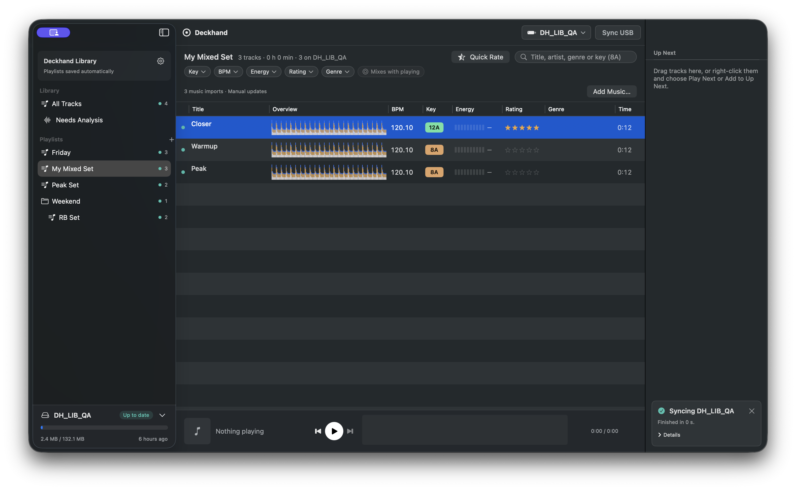

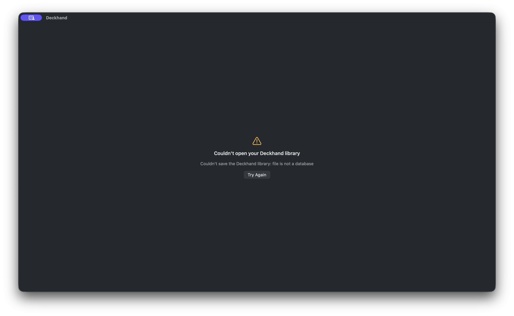

Original captures: `/Users/harlow/Desktop/SCREENSHOTS/screenshot-2026-10-10_20-32-47.png` and
`/Users/harlow/Desktop/SCREENSHOTS/screenshot-2026-10-10_20-33-37.png`.

## Scope of confidence

Persistence, source merging/switching, local edits, offline recovery, app-to-CLI analysis, XML exchange,
and actual FAT32/device-database output have been exercised. The 12-second WAVs test decoding and flow;
they do not evaluate analysis quality on full-length music.

Music writeback against a real Music library, manual import into Rekordbox desktop, and playback on
DJ hardware were not performed. Music writeback's orchestration and failure handling are covered with
the stateful destination. Cross-application writes can leave a partial remote result; the local library
remains saved and receipts checkpoint completed steps. See the source plan for conflict/retry limits.

## Earlier screenshot evidence

These screenshots document the earlier dedicated-library UI before the simplification above.
Captured from the running signed build on October 10, 2026. The populated screens use the isolated
test library described above. These are unedited native window captures. Originals are also saved
under `/Users/harlow/Desktop/SCREENSHOTS/`, at 15:52:41–15:55:09.

### Startup source chooser

Apple Music/iTunes, Rekordbox XML, and Folder on Computer are available, with a Start Empty option.

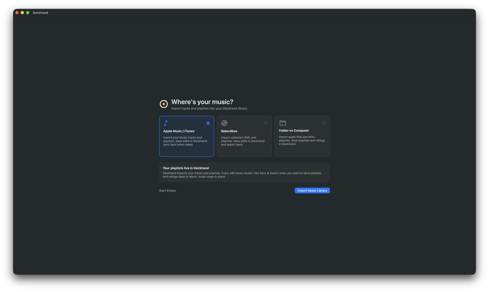

### Mixed playlist after restart and source disconnect

My Mixed Set still contains Closer, Warmup, and Peak, spanning folders A and B. Closer retains its
five-star local rating. The selected import source is Local Library, and the local-save notice is visible.

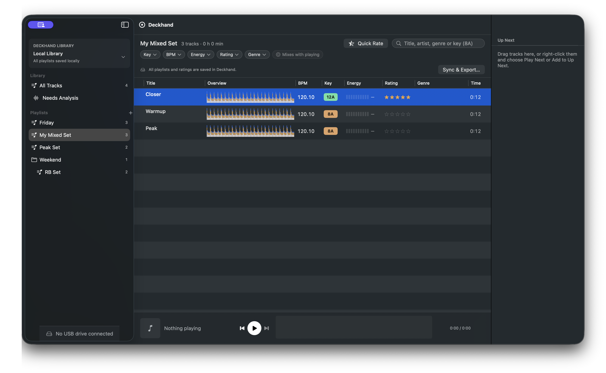

### Combined library

All Tracks contains four saved tracks. Folder and Rekordbox playlists remain together in the sidebar;
importing the XML references to existing audio did not duplicate those tracks.

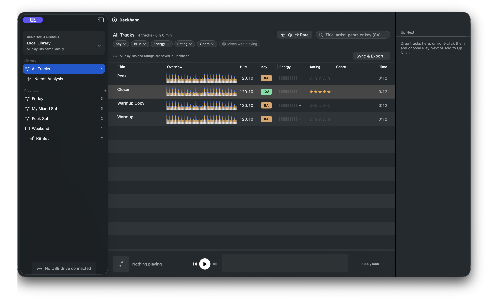

### Source connections

The chooser retains both folder connections and the Rekordbox XML connection. The saved library
remains visible behind the sheet.

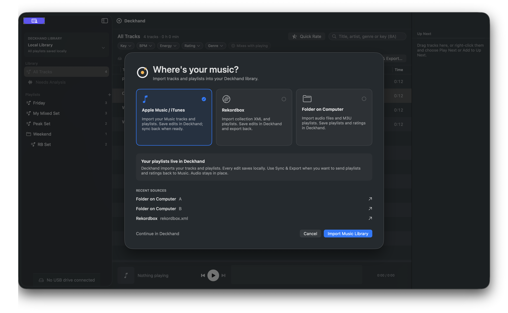

### Explicit sync and export

Music export has a playlist selection and describes its managed Deckhand copies. Rekordbox uses an
explicit XML export for subsequent import into Rekordbox. This capture shows the controls; it does
not establish successful writes to either desktop application. No USB was connected during capture.

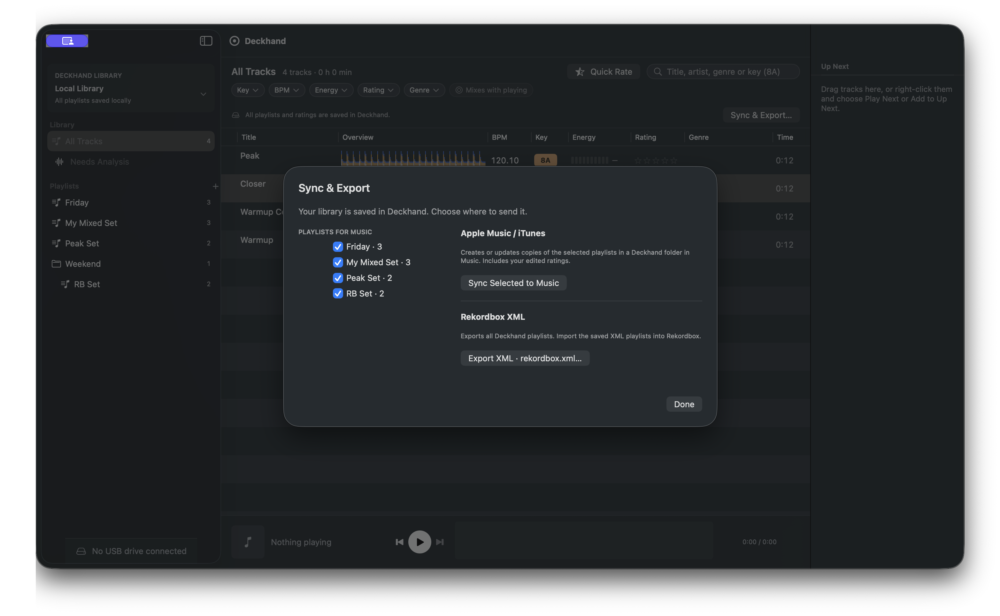

### Offline source files

Renamed test folder A and refreshed the local library: the app reports two unavailable audio files
while preserving all four track references, the three-track mixed playlist, and Closer's rating.
Restored A and refreshed afterward; the warning cleared and the saved playlist remained unchanged.

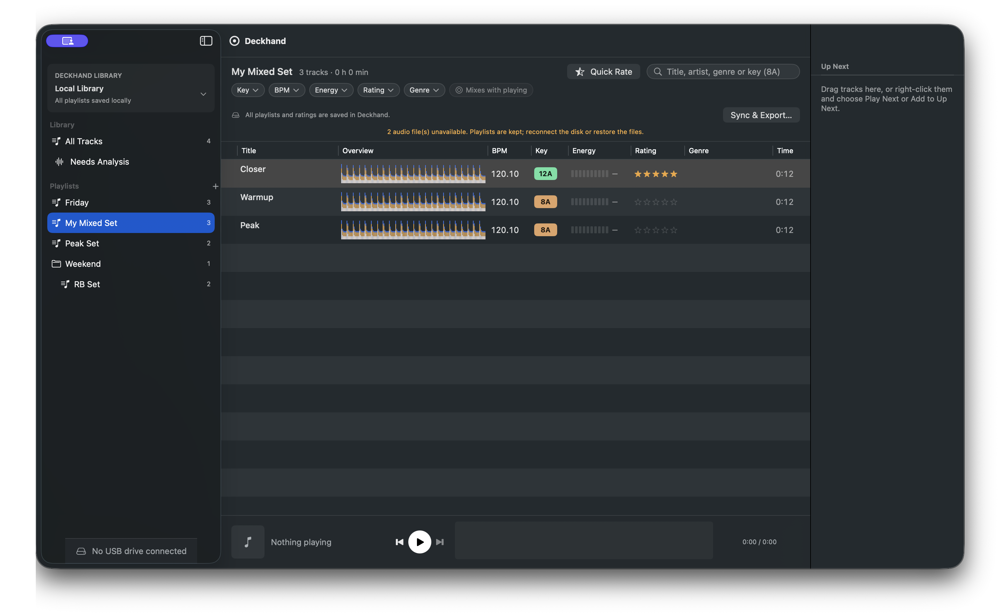


## Playlist folders: October 10 follow-up

Folders now expand/collapse when their label or disclosure arrow is clicked. The saved expansion
state is scoped to the local library directory. Hidden descendants are omitted from sidebar keyboard
navigation, while folder track totals and USB playlist selections still include them.

Playlists and folders carry a distinct drag payload; folder rows receive playlist moves, leaf rows
receive track additions, and the Playlists heading or All Tracks receives moves to the top level.
The plus menu creates either a playlist or a local folder. Right-click offers Move to Folder and
Move to Top Level as an accessible alternative. Moving into a collapsed destination reveals it.

The database saves parent placement separately from membership edits. Refreshing an imported
playlist retains its local placement while continuing to update untouched membership. Moves keep
record IDs, track membership, ratings, and USB selection. Self/descendant folder moves and missing
or non-folder destinations are rejected before committing.

Validation:

- Full suite: **219 tests / 43 suites passed in 27.513 seconds**; see
  [folder regression output](validation-evidence/folder-tests.log).
- Five new tests cover restart, local placement surviving refreshed XML membership, XML export
  hierarchy, invalid moves and atomicity, nested folder moves, collapsed keyboard order, track
  totals, stable USB selection, revealing collapsed ancestors, and separating track/playlist payloads.
- Signed debug app and bundled CLI rebuilt; signature verification and `git diff --check` passed.
- Native UI in **Deckhand Folder QA**, bundle ID `com.deckhand.folderqa`, using the isolated
  `/tmp/deckhand-folder-qa-20261010/Library`: created Local Sets; moved My Mixed Set into Weekend
  through its context menu; moved it back to top level; moved into collapsed Weekend and saw it
  automatically reveal the children; clicked to collapse/expand; restarted and confirmed the
  collapsed state and moved playlist persisted; arrow keys navigated Friday → Weekend → Local Sets,
  skipping the closed folder's children. The mixed playlist retained its three tracks and five-star rating.
- Native drag verified by the user in the final **Deckhand Folder QA** build: dragging Friday onto
  Weekend with their mouse moved the playlist into the folder. Automated computer-use drags started
  but did not reliably deliver drops, so this check is user-confirmed rather than an automated pass.
  The screenshots below demonstrate folder organization and collapse; they predate the user's drag check.
- Testing did not write to DECKHAND or DJTEST. DJTEST appears as an unrelated, unmatched mounted
  drive in the QA screenshots.

Evidence: [expanded folder with moved playlist](../images/library-evidence/15-playlist-folder-expanded.png)
and [collapsed folder with all four tracks retained](../images/library-evidence/16-playlist-folder-collapsed.png).

## One-library UI: October 10 follow-up

The workspace now has a single **Add Music…** action in the toolbar. Import provenance, update buttons,
update-default preferences and Music snapshot notices have been removed from the everyday screen.
The Library menu contains Add Music, Sync USB, Export Playlists and Library Settings.
Library Settings contains Import History, individual Re-import actions, import errors and conflicts,
and explicit export controls. Add Music uses the same shorter picker on first launch and later imports.

Saved-library reads no longer refresh the legacy selected input. Re-import explicitly names one input;
untouched imported playlists can receive its changes while local edits and parent placement remain saved.
Audio files stay at their original paths, and outgoing Music/Rekordbox exports remain explicit.

Validation:

- **220 tests / 43 suites passed in 22.686 seconds**. The new model test covers ordinary reads and restart
  without external imports, targeted re-import, locally saved playlists and ratings, folder placement,
  updated membership, stable library identity and persisted history dates. See
  [complete test output](validation-evidence/simple-library-tests.log).
- Signed debug app and bundled CLI rebuilt; signature verification and whitespace checks passed.
- Native walkthrough used **Deckhand UI QA**, bundle ID `com.deckhand.simpleqa`, with both library and cache
  isolated beneath `/tmp/deckhand-simple-qa-20261010`. Started empty, opened Add Music from the toolbar,
  imported two copied WAV files and the Friday M3U playlist, then imported a Rekordbox XML folder and playlist.
  The same two file identities were reused, and the copied analysis cache displayed BPM, keys and waveforms
  with Needs Analysis at zero. Saved Closer's five-star rating, re-imported the XML history entry to bring in
  Saturday, then restarted. The imported playlists, selection, rating, history dates and analysis remained.
  Earlier RB Set was retained when absent from the new XML, as intended for saved Deckhand playlists.
- Verified settings Add Music and Export Playlists close settings and open the corresponding main-window
  sheet. The export sheet was inspected and dismissed; this did not write to Music or Rekordbox.
- Disposable **DH_UI_QA** disk image: CLI sync copied two tracks into Friday, reported a clean final plan
  with zero analysis work, and CLI validation passed. See [sync output](validation-evidence/simple-library-usb-sync.log)
  and [validation output](validation-evidence/simple-library-usb-validate.log).
- **Native USB button remains unverified in this walkthrough**: QA drive discovery stalled inside a manifest
  file open, before publishing any drives. A process sample confirmed the blocked open; the exact cause
  was not established. No permission changes or writes to DECKHAND/DJTEST were made. The workspace capture
  therefore demonstrates the layout with no selected USB, not the connected-USB toolbar.

Screenshots of the final signed QA build:

- [Workspace without import bookkeeping](../images/library-evidence/17-simple-library-workspace.png)
- [Library Settings with Import History and Re-import](../images/library-evidence/18-simple-library-settings.png)
- [Add Music picker](../images/library-evidence/19-simple-add-music.png)

After testing, both temporary QA apps were closed and DH_UI_QA was ejected. The rebuilt production app
was opened from `build/Deckhand.app` without library/cache environment overrides. Its open database is
`~/Library/Application Support/Deckhand/Library/library.sqlite`; before opening, a SQLite backup and
copies of the cache index/fingerprints were saved beneath the QA directory. The normal database retained
2,195 track records and 16 playlist records, and its analysis directory retained 2,218 entries.

The normal workspace opened with the simplified UI, but analysis loading stalled in filesystem metadata
reads. macOS TCC logs reported a Media Library permission prompt for `rocks.deckhand.app` at 21:18:05.
This indicates authorization is pending; completed analysis loading in this production launch is not
verified. Computer use could not bind this production bundle ID (returned `Invalid app`), so permission
handling could not be completed through the tool. The app remains open for the user. Existing unavailable
track references were preserved rather than deleted. [Normal library opened, loading still pending](../images/library-evidence/20-normal-library-restored.png).


## Final simplicity pass

See [the completed simplification and evidence](library-ux-simplification.md#final-simplification-pass--october-10-2026).
The final suite passes 225 tests. Native USB setup and Sync USB are now verified using a disposable
FAT disk image, superseding the earlier native-USB test limitation. Cached startup was also repaired
and the normal library loaded analysis in 0.8 seconds without reanalysis. macOS developer-build
permissions can still hold up the already-mounted DECKHAND drive; no user USB was rewritten or reset.

## Playlist deletion — October 11, 2026

Sidebar playlists now offer **Delete Playlist…** on right-click, followed by a named confirmation.
Deletion is local: tracks, ratings and analysis remain, and source-app playlists are untouched.
Imported playlist deletions persist across restart and re-import. Deleting the current playlist opens
All Tracks and removes stale recent-playlist shortcuts. Folders do not offer this action.

- Full suite: **229 tests in 43 suites passed** (22.734 seconds).
- New coverage: imported deletion across restart/re-import and Rekordbox export; transactional rollback
  on failed deletion; local deletion and selection/recent cleanup; USB deletion on explicit sync while
  keeping audio used by another playlist, followed by a clean sync check and device database validation.
- Native **Deckhand Delete QA** used a copied isolated library. Right-click and the named confirmation
  were observed. The subsequent workspace shows Friday absent, both tracks and cached waveforms present,
  and Closer's five-star rating retained. No normal-library playlist or user USB was deleted for testing.

[Native QA result](../images/library-evidence/26-delete-playlist-result.png).
[Full test output](validation-evidence/playlist-delete-tests.log).
