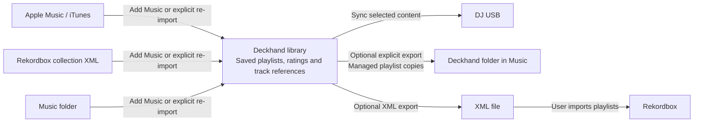

# Make the dedicated library easy to understand

**Status:** Implemented and validated locally
**Date:** October 10, 2026 
**Current implementation:** [Library sources](library-sources.md)

## Recommendation

Keep one persistent Deckhand library. **Add Music…** brings tracks and playlists from Apple Music,
Rekordbox XML, or a folder into it. Imports are occasional actions, not ongoing sources that users
must switch or maintain. Playlists and ratings save locally; **Sync USB** is the everyday outgoing action.

Do not create a separate Deckhand library for every source or lock a library permanently to its first
source. That would introduce library switching, separate playlist collections, and questions about which
library owns a USB. A user who moves from Music to Rekordbox should keep their Deckhand playlists and
USB selections.

Import history and an optional **Re-import** action live in Library Settings. The main workspace
has no import provenance, update button, or default-for-updates preference. Existing stored defaults
remain compatible with older data but are not used by the interface or saved-library reads.

## How the current data flow works

All playlist edits and ratings save in Deckhand. Audio remains at its existing file paths; the library
does not make a managed copy of every audio file. Import connections and outgoing destinations are
independent. A folder import can produce Music playlist copies, and a Music import can sync to a USB.
Rekordbox exchange is file based and requires manual XML export/import, rather than live two-way sync.

## The default user journey

1. **Add Music…**: choose Apple Music, Rekordbox XML, or a folder. First launch also offers Start Empty.
2. Later launches: open the same saved library directly. No source chooser during ordinary use.
3. Organize and rate tracks. Edits save automatically in Deckhand.
4. Connect a USB, choose which playlists it should contain, and click **Sync USB**.
5. If desired, explicitly export playlists back to another application.

## Implemented UI changes

| Surface | Behavior |
| --- | --- |
| Library identity | Always show **Deckhand Library**. Remove the prominent dropdown whose title changes between Music, Rekordbox, Folder and Local Library. |
| Import status | Removed from the workspace. Dates, locations, errors and import conflicts are available in Library Settings. |
| Re-import | Explicitly re-import one history entry in Library Settings. Opening or rereading the saved library never imports external changes. |
| More music | **Add Music…** adds a folder, another XML snapshot, or another supported import without implying a replacement library. |
| USB connected | Keep the playlist list stable. Show per-playlist selection/status for the selected USB and its storage/status in the drive footer. Avoid rearranging the entire sidebar when a USB appears. |
| Main action | **Sync USB** clearly targets the selected drive and does not require choosing among Music, XML and USB each time. |
| Other exports | **Export Playlists…** in the Library menu. Offer Music/XML actions separately from the everyday USB workflow. |
| Library settings | **Import History** lists previous inputs with a **Re-import** action. There is no update-default picker or connection-management workflow. |

The chooser is titled **Add Music** both on first launch and when adding more music. It states that
playlists and ratings save in Deckhand and audio stays where it is. Export instructions live in the
explicit export flow. There is one library and no multi-library navigation.

## Set honest expectations about imported playlists

The main remaining complexity is ownership, not how many sources are supported. A user may expect an
edit in Deckhand to change their original Music or Rekordbox playlist immediately. On first import,
state: **Your playlists are saved in Deckhand. Edits here stay here until you export them.**

Current refresh behavior updates untouched imported playlists, preserves locally edited playlists,
and reports disagreement with later source changes. External deletion does not delete the saved
Deckhand copy. Keep these protections; a later conflict-resolution screen can offer a concrete choice
between keeping the Deckhand version and accepting the imported version. Do not promise automatic
two-way synchronization.

Music export currently updates managed copies in a Deckhand folder, not the original imported
playlists. Label and explain that result before the outgoing action. Rekordbox export must say
**Export XML for Rekordbox**, since the user completes the import in Rekordbox.

## Validation

The implementation preserves the existing database, adapter interfaces, stable IDs, analysis cache
and USB ownership rules. The complete suite passes **220 tests in 43 suites**. A new regression verifies
that saved-library reads and restart do not import external changes, re-import targets the chosen
history entry, and local playlists, ratings, folder placement and the library ID survive.
Native testing in the separately named Deckhand UI QA app covers Add Music, folder and Rekordbox imports,
history, re-import, explicit export controls and restart. Startup waits for the saved-library check
before showing the chooser; saved empty libraries also open directly into the workspace.
See [the test report and screenshots](dedicated-library-e2e.md).

Explicit conflict resolution and real desktop Music/Rekordbox writeback checks remain future work;
this simplification does not promise continuous two-way synchronization.

## Final simplification pass — October 10, 2026

The main screen keeps the original DJ workflow: library and playlists at left, tracks and filters in
the center, playback and Up Next. Add Music is the only everyday import action. The extra library
identity card is gone; a small gear beside Library opens settings. Add Music presents three direct
actions, without selecting a source and then confirming it. Folder is listed first.

Import History is collapsed by default in Library Settings. Re-import names the input explicitly;
there is no default for updates. Export Playlists is secondary, with one destination at a time.
Music exports begin with only the open playlist selected (none from All Tracks), and changing Music
ratings is an opt-in. Rekordbox XML exports clearly include all saved playlists and preserve original
track IDs/cues from an imported collection.

USB controls have one primary toolbar action: Set Up USB, Connect USB, or Sync USB. Drive selection,
capacity and Eject are together in the sidebar footer. Connection explanations appear in a sheet when
requested, instead of permanently occupying the workspace. A mismatched USB cannot claim Up to date;
its track counts and playlist sync dots are hidden. Linking an old drive still requires proof that all
its existing track IDs, playlists and selections survived import. All Tracks adoption explicitly warns
that the next sync includes the entire combined library. Setup never formats a USB. It explains that
sync replaces the Rekordbox export database. Unreadable existing manifests cannot be treated as blank
drives.

Needs Analysis contains the Analyze Library action; it is also available from the Library menu.
Opening Deckhand only loads cached analysis. It never hashes unseen audio merely to open the workspace.
File metadata uses stat without extended attributes, with Foundation-compatible timestamp arithmetic
so existing fingerprint keys remain valid. Explicit Analyze and Sync still validate/read audio.

### Validation

- Full suite: **225 tests, 43 suites passed**. New cases cover untouched USB setup/mismatch, corrupt
  manifest protection, opt-in Music ratings, cached startup without audio hashing, and exact legacy
  fingerprint timestamp compatibility. Existing mixed-import, local edits, restart, folder, ownership,
  sync recovery and property tests pass.
- Native isolated app: set up a fresh FAT USB disk image, selected Friday, synced through the toolbar,
  reached Up to date, then restarted with the same playlists, rating, analysis and drive selections.
  Validator reported no problems. Only the disposable image was written and it was ejected afterward.
- Re-imported the fixture folder through the direct Add Music action: no duplicate tracks, lost ratings,
  or changed USB selection. Settings expanded/collapsed and Done/Export transitions worked.
- Native XML export produced two tracks and Friday / Weekend / RB Set / Saturday. No Music writes
  were made during native testing; its default and opt-in ratings paths use a stateful test destination.
- Selected DJTEST only to inspect mismatch help; no adoption, setup or sync was performed on that USB.
- Main build reopened the normal saved library and cache. Cached analysis finished in **0.8 seconds**;
  no analysis files or playlists were reset. Old QA records already in the normal database were preserved.
- Built app passed codesign verification and git diff whitespace checks.
- Claude CLI supplied a read-only UX review and code review. Accepted the USB loading/error cases and
  ratings default. Its concurrent-export concern was already covered by sourceCanChange; Settings Done
  was verified in the actual Settings window. Review reports are saved with validation evidence.

Evidence: [workspace + USB](../images/library-evidence/21-simplified-workspace-usb.png),
[Add Music](../images/library-evidence/22-simplified-add-music.png),
[settings](../images/library-evidence/23-simplified-settings.png),
[USB connection help](../images/library-evidence/24-contextual-usb-help.png),
[normal library, cached analysis loaded](../images/library-evidence/25-normal-library-after-simplification.png),
[test log](validation-evidence/simplified-library-tests.log),
[USB validation](validation-evidence/simplified-native-usb-validation.log).

### Remaining environment limitation

The installed code-signing identity inventory has no usable certificates. Builds therefore still fall
back to ad-hoc signing, which can cause macOS to request Music or removable-volume permissions after a
changed build. The script accepts DECKHAND_SIGN_IDENTITY when a stable certificate is installed and
DECKHAND_APP_PATH for isolated QA builds. No privacy settings were bypassed. Native USB sync was verified
with the disposable QA drive; the main app's already-mounted DECKHAND drive was still waiting on its
read/access request. It is separate from analysis loading, and another drive can finish loading independently.
