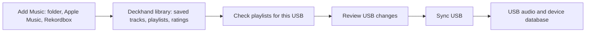

# Restore a clear USB sync workflow

October 11, 2026. Reviewed with Claude through its CLI, then implemented and tested.

## What went wrong

DECKHAND was physically connected and readable, but its manifest belonged to an earlier Deckhand
library UUID. All 12 track IDs and both selected playlist IDs were in the current library. Adoption
incorrectly required that older UUID to be an import connection ID, so it failed. The UI then hid all
sync badges and diffs and offered “Connect USB” and an inaccurate missing-import explanation.

The local library stays. Importing and USB sync are independent operations:

## Everyday experience

- **Add Music…** lives in Library Settings; the sidebar keeps just its settings gear. It imports
  tracks and playlists into the existing Deckhand library. Audio stays in its
  original location; importing doesn't write the USB or automatically write back to another app.
- Each playlist has a persistent checkbox when a compatible USB is present. Checked playlists are
  selected for that USB. Folders indicate partial selection and can include/exclude their descendants.
  All Tracks separately selects every library track.
- A green status dot means up to date; orange means pending changes. The toolbar restores **N to sync**
  and copy size when there is audio to copy. Clicking the drive/status opens the selected playlists and
  the engine's detailed diff. When fully synced, the toolbar shows only the drive name and disables
  Sync USB; incomplete checks and pending changes keep the action available.
- **Sync USB** applies changes. Unchecking a playlist doesn't immediately remove its audio or device
  database entry. When nothing remains selected, Sync opens a confirmation before removing all
  Deckhand content from the USB; the computer library remains saved.

## Older-library USBs

The toolbar keeps **Sync**, including for an earlier-library USB. A one-time confirmation displays
“Sync [drive] from this library?” and the proposed changes. A read-only preview appears
only when all recorded track, playlist and selection IDs exist locally and the owner is a recognized
prior Deckhand library or a known import. It never grants execution permission to the sync engine.

Explicit association verifies the older Deckhand library's recorded audio hashes using the sync
cache, pins the USB owner/device/generation and local revision, and checks its write lock. Local edits
are blocked during association. Only the manifest owner/format/generation change; existing selections,
audio and the device database remain during that step. The old library can no longer sync the USB.
After successful verification, the confirmed Sync continues into the normal sync engine. Clearing
all USB content still requires the separate removal confirmation. A different active drive is never
synced by this continuation. Missing records, mismatched/unavailable audio,
unknown owners, concurrent changes and busy drives are refused with an explanation.

Claude's second review led to the clear-all confirmation, consistent review wording, friendly audio
verification errors, and a stronger assertion that a held drive lock is actually reported to the user.

## Verification

- **232 tests in 43 suites passed** (29.566 seconds). New tests cover byte-for-byte read-only preview,
  retained selection and records after association, audio mismatch, concurrent manifest change, drive
  lock, deleted-playlist safety, clear-all confirmation, and a complete removal-only sync/validator.
- Native **Deckhand Sync QA**, using an isolated copied library and a disposable 128 MB FAT32 image
  named **DH_SYNC**, reproduced the previous-library UUID problem.
- Preview left all ten tracked USB files unchanged. Association changed only a manifest file and
  retained both audio files, playlist selection and device database.
- Native checkbox exclusion removed Friday from selection while retaining RB Set. The toolbar and
  preview showed two changes. Native Sync USB succeeded; validation reported no problems and the
  follow-up dry run reported zero pending changes.
- Reopening the final build retained selection. Re-including Friday produced a visible pending
  checkbox/status and an accurate create/sequence preview; a second native sync finished up to date
  and passed device validation.
- Normal library and real DECKHAND manifest/database fingerprints were unchanged after rebuilding
  and reopening the normal app. The disposable USB was ejected after QA.
  No user USB was associated, synced, reformatted or reset during QA.

Evidence: [playlist selection](../images/library-evidence/27-usb-playlist-selection.png),
[quieter final toolbar](../images/library-evidence/30-quiet-library-toolbar.png),
[diff preview](../images/library-evidence/28-usb-sync-preview.png),
[normal app reopened](../images/library-evidence/29-real-usb-library-review.png),
[test output](validation-evidence/usb-sync-restoration-tests.log),
[device validation](validation-evidence/usb-sync-restoration-validation.log),
[user data unchanged](validation-evidence/usb-sync-restoration-user-data-check.json).

The quieter toolbar was rebuilt and verified in the native QA app: Library Settings opens Add Music,
the synced state disables Sync USB, and changing the selection enables it with the pending count.
All 20 dedicated library model tests passed ([output](validation-evidence/quiet-toolbar-tests.log)).
